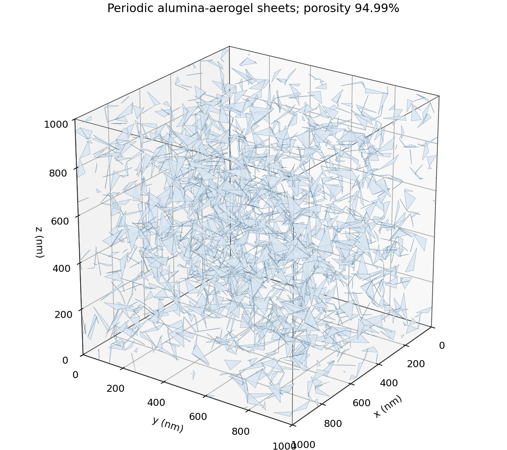
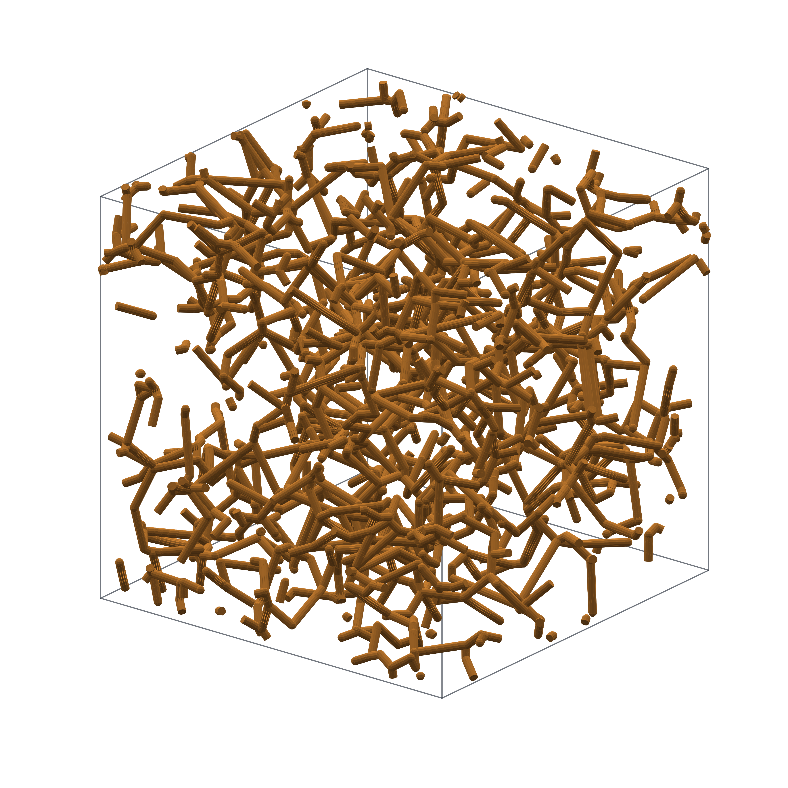

# Periodic Voronoi Aerogels

用 Python 生成三维周期 Voronoi 气凝胶几何微结构：**氧化铝气凝胶片层网络**和**纳米线气凝胶骨架**。支持调节胞元尺寸、片层厚度或纳米棒直径、目标孔隙率和随机种子，并输出结构演示图及相应网格。

这些模型是随机几何结构生成器，可用于形态展示和后续建模准备；尚未通过显微图像反演或实验数据校准。代码生成几何，不计算材料热学或光学响应。

## 模型与示例

| | 片层模型 | 纳米线模型 |
| --- | --- | --- |
| Python 包 | `voronoi_aerogel` | `voronoi_nanowire` |
| 几何基础 | Voronoi 公共面 | Voronoi 公共面的交线 |
| 默认胞元 | 1000 nm 立方体 | 1000 nm 立方体 |
| 默认厚度 / 直径 | 厚度 5 nm | 直径 20 nm |
| 默认目标孔隙率 | 95% | 95% |
| 主要输出 | PNG、封闭体素实体 STL、中面 BDF、周期节点配对 | PNG、离线交互 HTML、展示 STL |
| 中文教程 | [片层模型](docs/sheet_model_zh.md) | [纳米线与 Spyder 分步操作](docs/nanowire_model_zh.md) |

<table>
<tr><th>片层网络，目标孔隙率 95%</th><th>纳米线网络，目标孔隙率 97%</th></tr>
<tr><td></td><td></td></tr>
</table>

纳米线 [95%](examples/nanowire_p95/preview.png)、[97%](examples/nanowire_p97/preview.png)、[99%](examples/nanowire_p99/preview.png) 示例采用相同胞元、直径、随机种子和视角。每组均附实际配置和元数据，见 [示例说明](examples/README.md)。边界处看似分离的结构会在周期胞元的相对面继续连接。

## 安装

需要 **Python 3.11 或更新版本**。下载或克隆仓库后，在项目根目录打开终端：

```bash
python -m pip install -e .
```

依赖为 NumPy、SciPy、scikit-image、Matplotlib 和 Plotly，安装时由 pip 自动处理。也可以直接安装 `requirements.txt` 后在项目目录运行。Spyder 用户应把依赖装入 Spyder 实际使用的 Python 环境。

## 生成片层模型

先运行较轻的流程检查，再生成正式模型：

```bash
python -m voronoi_aerogel.cli --config default_config.json --quick --output output/sheet_quick
python -m voronoi_aerogel.cli --config default_config.json --output output/sheet_full
```

在 `default_config.json` 修改 `cube_size_nm`、`thickness_nm`、`diameter_min_nm`、`diameter_max_nm` 和 `target_porosity`。片层等效直径是偏好范围，不是每个面的固定尺寸。

默认正式体素网格约为 **400³，即 6400 万体素**，网格提取和质量分析会额外占用内存；`--quick` 默认约为 200³。先检查快速模式，定量使用前比较更细分辨率的结果。

## 生成纳米线模型

```bash
python -m voronoi_nanowire.cli --config nanowire_config.json
python -m voronoi_nanowire.cli --config nanowire_configs/porosity_97.json --stl
python -m voronoi_nanowire.cli --config nanowire_configs/porosity_99.json
```

在 `nanowire_config.json` 修改 `cube_size_nm`、`rod_diameter_nm`、`num_seeds` 和 `target_porosity`。也可以临时覆盖目标和输出目录：

```bash
python -m voronoi_nanowire.cli --config nanowire_config.json --porosity 0.97 --output output/trial_p97 --stl
```

**在 Spyder 中分两步运行：** 打开 `run_nanowire_spyder.py`，直接修改 `NanowireConfig(...)` 内的参数。先保持 `STEP = "image"`，按 F5 运行整个文件生成图片和网格缓存；随后只改成 `STEP = "stl"`，再次运行以导出同一结构的 STL。脚本使用自身所在目录定位输出。如果修改了结构参数，应重新执行图片步骤。详见[中文操作教程](docs/nanowire_model_zh.md)。

## 方法与孔隙率

1. 在立方体内生成带最小间距约束的随机种子，以 3 × 3 × 3 周期复制建立三维 Voronoi 剖分。
2. 将完整的逻辑公共面或交线作为候选片层或纳米棒，保留连通且沿三个周期方向贯通的逻辑骨架，再随机添加相邻候选单元。
3. 以有限厚度片层或有限直径胶囊体的**并集**计算固相占比，重叠只计一次。用 scrambled Sobol 采样估计 `孔隙率 = 1 − 固相并集体积 / 胞元体积`。
4. 使用另一组 Sobol 点报告独立估计，并输出选中结构、拓扑和分辨率相关记录。完整边或面的离散选择只能在容差内逼近目标；程序不自动增厚结构来满足目标。

所有几何配置的长度单位为 **nm**，孔隙率为小数：`0.95` 表示 95%，`porosity_tolerance=0.005` 表示绝对误差 0.5 个百分点。固定随机种子可重复生成；不同数值库版本可能带来浮点或剖分差异，研究中应保存配置、元数据和软件版本。

## 输出、单位和适用范围

| 文件 | 说明 |
| --- | --- |
| `preview.png` | 结构静态演示图 |
| `config_used.json` / `metadata.json` | 实际参数、孔隙率估计、拓扑及输出记录 |
| `aerogel_solid_nm.stl` | 片层体素并集封闭网格；数值坐标为 nm |
| `aerogel_shell.bdf` | 片层中面和壳厚度；数值单位为 μm |
| `periodic_node_pairs.json` | 片层相对边界的节点映射；坐标为 nm |
| `import_lumerical.lsf` / 生成的 solver README | 外部求解器导入模板和说明，需在实际软件中验证 |
| `nanowire_preview.html` | 可离线旋转、缩放的纳米线展示 |
| `nanowire_display_nm.stl` | 使用 `--stl` 或 Spyder 第二步生成的纳米线展示网格；坐标为 nm |

STL 格式不记录单位，导入时需手动确认缩放。**纳米线 STL 的圆柱与节点球没有进行布尔并集，不保证水密或严格裁剪到胞元边界，不能直接作为已验证的打印或有限元实体。** 它的网格体积也不能代替 Sobol 并集孔隙率。

片层的控制采样用于目标容差判定；独立采样、体素占比及 STL 体积孔隙率另行报告，可能存在差异。三向贯通检查针对逻辑网络；粗体素化后孔相的物理贯通性没有独立验证。报告的可达区间取决于当前约束和骨架生长策略，并不证明其他所有结构都不可行。程序正常退出且最终 `metadata.json` 已写出，才表示完整运行成功。

## 项目结构与测试

```text
voronoi_aerogel/          片层几何、拓扑、选面、实体网格和导出
voronoi_nanowire/         选边、胶囊体积估计、渲染和展示 STL
run_nanowire_spyder.py    Spyder 参数修改及分步入口
default_config.json      片层默认参数
nanowire_config.json     纳米线默认参数
nanowire_configs/        95%、97%、99% 参数
docs/                    中文使用教程
examples/                精选演示图、配置和元数据
tests/                   几何、拓扑、并集、渲染和网格测试
```

```bash
python -m pip install -e ".[dev]"
python -m pytest
```

纳米线包复用了片层包中的周期几何和拓扑工具，使用时请保留两个包。生成的完整 STL、交互 HTML 和缓存写入 `output/`，由使用者本地生成。

## English overview

This repository generates synthetic, triply periodic 3D Voronoi aerogel geometries: finite-thickness sheet networks for alumina aerogel modelling and finite-diameter nanowire networks for visualisation. Porosity is estimated from the physical union using scrambled Sobol samples, including overlap. It is a stochastic geometry generator, not an experimentally calibrated image reconstruction method.

Install with `python -m pip install -e .` (Python ≥ 3.11). Use the module commands above, JSON configuration files, or edit and run `run_nanowire_spyder.py` in Spyder. Length inputs and STL coordinates use nm; BDF shells use μm. Nanowire STL files are display meshes, not Boolean-unioned watertight solids. Consult the Chinese guides for parameter tables, numerical limitations and workflow details.

## 许可证与贡献

本项目代码、文档和自生成示例采用 [MIT License](LICENSE)。第三方依赖沿用各自许可证，未随本仓库分发其源码。问题反馈请附配置、Python/依赖版本和报错信息；贡献说明见 [CONTRIBUTING.md](CONTRIBUTING.md)。
